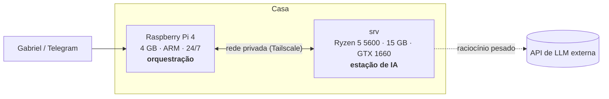

# homelab

Laboratório pessoal de **IA privada, agentes e infraestrutura**, rodando em hardware modesto em casa:
um Raspberry Pi 4 e um servidor com GPU de entrada (GTX 1660, 6 GB).

A proposta é mostrar que dá para montar uma plataforma de IA séria sem nuvem cara, com dois princípios:

- **Dado sensível não sai de casa.** Tarefas simples ou com dado privado rodam em modelo local;
  só raciocínio pesado vai para API externa (arquitetura híbrida).
- **Medir antes de construir.** Toda escolha relevante tem critério definido *antes* do teste
  e veredicto registrado depois (ver [`docs/decisoes/`](docs/decisoes/)).

> Status: Etapa 0 concluída; **Etapa 1 — gateway** no ar com rota local e nuvem gratuita. O histórico completo está nas
> [issues](../../issues?q=is%3Aissue) e [milestones](../../milestones).

## Resultados até agora

| | |
|---|---|
| 🔒 **Hardening do servidor** | Nota Lynis **62 → 69**; achado: SSH exposto em IPv6 global sem firewall ([relatório](docs/seguranca/0001-hardening-srv.md)) |
| 🔑 **Segredos vazados** | 21 repositórios varridos no histórico completo, **0 em públicos**, com controle positivo ([relatório](docs/seguranca/0002-varredura-segredos.md)) |
| 🎮 **GPU** | Driver com Secure Boot ligado, sem acesso físico; GPU disponível em containers ([ADR 0002](docs/decisoes/0002-driver-nvidia-secure-boot.md)) |
| 🚪 **Gateway de IA** | Bifrost com chave por projeto, fallback local → nuvem gratuita, chave privada que falha fechado (auditado), orçamento e logs sem conteúdo; 22/22 testes de aceitação; overhead de 0,7 ms. LiteLLM recusado por ataque de supply chain na véspera ([etapa 1](docs/etapa-1.md), [ADR 0004](docs/decisoes/0004-gateway-bifrost.md)) |
| 🧪 **Benchmark pré-registrado** | 4 modelos locais; 2 GO. Padrão `gemma4:e4b`: 96% em alertas, 97% em extração, 74 tokens/s. Modelos de 8–9B não cabem e não acertam mais ([resultados](docs/benchmarks/0001-resultados.md)) |

## Arquitetura

| Máquina | Papel |
|---|---|
| **Raspberry Pi 4** (4 GB, ARM) | Ligado 24/7, consumo baixo: agenda tarefas, monitora, conversa via Telegram |
| **srv** (Ryzen 5 5600, 15 GB, GTX 1660 6 GB, Ubuntu 24.04) | Estação de IA: modelos locais, processamento pesado, dados dos projetos |

Detalhes em [`docs/arquitetura.md`](docs/arquitetura.md).

## Roadmap

| Etapa | Entrega | Status |
|---|---|---|
| **0 — Fundação** | Mapa do lab, segurança básica, GPU funcionando, benchmark de modelos locais | ✅ concluída |
| **1 — Plataforma de IA privada** | Gateway único que roteia entre modelo local e API externa, com painel de custo/uso | 🟡 local + nuvem gratuita prontos; rota paga futura |
| **2 — Agente SRE** | Agente que investiga alertas da infra e pede aprovação humana no Telegram | ⚪ |
| **3 — Solução aplicada** | Caso real de empresa em cima das etapas 1–2 | ⚪ |

Trilha paralela de **segurança defensiva**: caça a segredos vazados → hardening com nota antes/depois
→ scanner de vulnerabilidades → mini-SOC com agente explicando alertas.

## Como este repositório é usado

- Cada passo vira uma **issue** com critério de pronto; o trabalho fecha a issue por commit.
- Decisões importantes viram **ADR** em [`docs/decisoes/`](docs/decisoes/).
- Resultados de medição ficam em [`docs/benchmarks/`](docs/benchmarks/) e [`docs/seguranca/`](docs/seguranca/).
- Nenhum segredo, IP interno ou dado de terceiros entra no repositório.

## Licença

[MIT](LICENSE)
