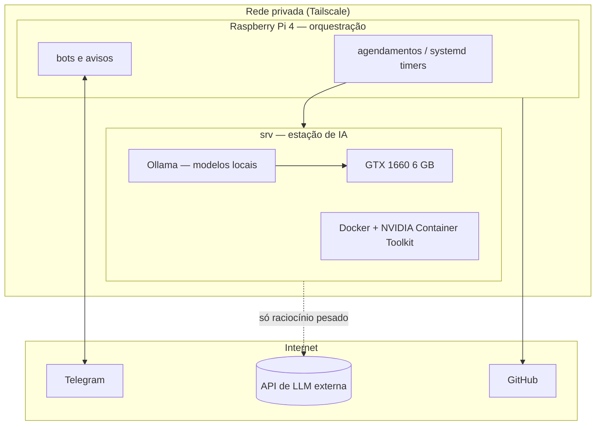

# Arquitetura

## Visão geral

## Máquinas

### Raspberry Pi 4
- 4 GB RAM, ARM64, SSD via USB.
- Sempre ligado; papel de **gerente**: dispara rotinas, recebe e envia mensagens, guarda o histórico.

### srv
- Ryzen 5 5600 (12 threads), 15 GB RAM, NVMe 256 GB + SSD SATA 128 GB.
- GTX 1660 (Turing, 6 GB VRAM, sem tensor cores).
- Ubuntu Server 24.04, Docker.
- Papel de **estação de IA**: roda os modelos locais e o processamento pesado.

## Rede

- Todo acesso entre máquinas passa pela **Tailscale** (rede privada com WireGuard).
- Serviços novos publicam porta **apenas** na interface da Tailscale, nunca em `0.0.0.0`.

## Limites conhecidos

- 6 GB de VRAM limitam modelos locais a ~3B–8B parâmetros quantizados.
  A Etapa 0 mede exatamente o que cabe e o que funciona ([`benchmarks/`](benchmarks/)).
- O Pi não tem relógio de hardware (RTC): após queda de energia, o horário só se corrige via NTP.
