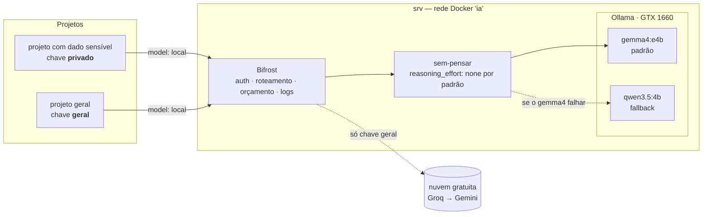

# Etapa 1 — Plataforma de IA privada

Um **gateway único** na frente dos modelos. Os projetos não falam com o Ollama nem com a nuvem:
falam com o gateway, com uma chave que define o que podem usar, quanto podem gastar e o que
fica registrado.

## Arquitetura



## Como um projeto usa

O gateway fala o protocolo da OpenAI, então qualquer SDK compatível funciona trocando a URL:

```bash
curl http://<srv-na-tailscale>:8080/v1/chat/completions \
  -H "Authorization: Bearer $CHAVE_DO_PROJETO" \
  -H "Content-Type: application/json" \
  -d '{"model": "local",
       "messages": [{"role": "user", "content": "Classifique este alerta: ..."}]}'
```

- `model: "local"` é um **apelido**: o gateway decide o modelo. Cadeia: gemma4 → qwen3.5 local →
  qwen3.8-27b na Groq → Gemini Flash-Lite. A chave decide até onde a cadeia pode ir.
  Trocar de modelo, ou de GPU, não muda nada no projeto.
- **Modelo local não "pensa" por padrão.** Sem `reasoning_effort`, o gateway impõe `none` nos
  modelos locais (o qwen pensaria e ficaria 20–30× mais lento; [ADR 0007](decisoes/0007-proxy-sem-pensar.md)).
  Para raciocínio, peça `"reasoning_effort": "high"`. Na nuvem gratuita o padrão não é imposto:
  para tarefas simples pela chave `geral`, mande `"none"`; todos os modelos da cadeia aceitam
  ([ADR 0005](decisoes/0005-rota-nuvem-gratuita.md)).

## Chaves

| Chave | Pode usar | Limites | Conteúdo no log |
|---|---|---|---|
| `privado` | só modelos locais | 600 req/h | **não** |
| `geral` | local + Groq + Gemini (gratuitos) | US$ 5/mês, 25 req/min | não (padrão global) |
| `teste-orcamento` | só locais | US$ 0,0005/h | não |
| `teste-limite` | só locais | 3 req/min | não |

Os valores das chaves são gerados no próprio servidor e ficam num `.env` com `chmod 600`.
O repositório só tem as referências (`env.VK_PRIVADO`).

## Custo-sombra

Modelo local não custa nada por chamada. Para o painel mostrar algo útil, os modelos locais são
precificados como o **Claude Haiku 4.5** (US$ 1 / US$ 5 por milhão de tokens de entrada/saída):
o número no painel é **quanto o mesmo uso custaria na nuvem**. Não é gasto real.

## Segurança

- Imagens fixadas por digest; Bifrost com quarentena de 72 h por versão ([ADR 0004](decisoes/0004-gateway-bifrost.md)).
- Portas só em localhost e na Tailscale; pela rede local nem conecta.
- Container do gateway read-only, sem capabilities, usuário sem root. O proxy `sem-pensar` idem,
  em imagem `scratch` (sem shell) e sem porta publicada: só o Bifrost o alcança, pela rede `ia`.
- Inferência e painel exigem autenticação.
- O Bifrost bloqueia por padrão conexões a IPs privados (proteção anti-SSRF). A exceção foi
  aberta **só** para o provider do Ollama.
- Saídas de rede esperadas: tabela pública de preços do Bifrost (a cada 24 h), Groq e Gemini (só chave `geral`).
- A rota gratuita **pode treinar com os dados** (Gemini declara isso, e humanos podem revisar). Decisão aceita para o lab; dado pessoal ou confidencial não passa por ela, por termo do provedor.

## Resultado do teste de aceitação

[`tests/aceitacao_etapa1.py`](../tests/aceitacao_etapa1.py) `--fallback --overhead --queda`, rodado no srv em 2026-10-23 (após o proxy `sem-pensar`, #13):

```text
[PASSA ] inferência sem chave é recusada — HTTP 401
[PASSA ] inferência com chave falsa é recusada — HTTP 401
[PASSA ] API de gestão sem login é recusada — HTTP 401
[PASSA ] API de gestão com login funciona — HTTP 200
[PASSA ] chave 'privado' + apelido 'local' responde pelo gemma4 — HTTP 200, modelo gemma4:e4b
[PASSA ] chave 'privado' não acessa modelo fora da lista (llama3.1:8b existe no Ollama) — HTTP 403: Model 'llama3.1:8b' is not allowed for virtual key 'privado'
[PASSA ] reasoning_effort='none' desliga o 'pensar' do qwen — 2 tokens de saída em 4.5 s
[PASSA ] sem reasoning_effort, o gateway impõe 'none' ao qwen (#13) — 2 tokens de saída em 0.1 s
[PASSA ] reasoning_effort='high' do cliente é preservado (qwen continua pensando) — 237 tokens de saída em 4.8 s
[PASSA ] com o gemma4 fora, 'local' cai no qwen3.5:4b — HTTP 200, modelo qwen3.5:4b
[PASSA ] gemma4 restaurado e de volta ao serviço — modelo gemma4:e4b
[PASSA ] limite de 3 req/min bloqueia com 429 — códigos [200, 200, 200, 429, 429]
[PASSA ] orçamento de US$ 0,0005/h bloqueia com 402 — 0 chamadas aceitas antes do bloqueio
[PASSA ] logs da chave 'privado' não guardam conteúdo — 5 registros conferidos
[PASSA ] logs registram custo-sombra
[PASSA ] chave 'privado' recusada ao pedir groq — HTTP 403: Provider 'groq' is not allowed for virtual key 'privado'
[PASSA ] chave 'privado' recusada ao pedir gemini — HTTP 403: Provider 'gemini' is not allowed for virtual key 'privado'
[PASSA ] chave 'geral' usa groq com o contrato reasoning_effort='none' — HTTP 200 em 1.1 s
[PASSA ] chave 'geral' usa gemini com o contrato reasoning_effort='none' — HTTP 200 em 0.8 s
[PASSA ] Ollama parado: 'geral' continua respondendo pela nuvem — HTTP 200, modelo gemini-3.5-flash-lite, 2.1 s
[PASSA ] Ollama parado: 'privado' falha fechado (não responde) — HTTP 502
[PASSA ] tentativas de nuvem da 'privado' barradas antes de sair (sem chave de provedor, sem tokens) — 2 tentativas auditadas no log
[PASSA ] Ollama religado e 'privado' de volta ao local — modelo gemma4:e4b
[PASSA ] overhead mediano do gateway ≤ 50 ms — mediana 1.0 ms (p10 0.3, p90 1.6; 30 pares)

24 passaram, 0 falharam, 0 pulados
```

O fallback é testado com **falha real**: a tag do gemma4 é removida do Ollama e restaurada no fim,
e na queda total o container do Ollama é parado e religado.

## O que aprendemos

- **A ordem importa:** a permissão da chave é checada antes da regra de roteamento. E a variável
  CEL é `model`, não `request.model`. Regra com sintaxe inválida é pulada com um aviso no log, sem erro.
- **Parâmetro nativo nem sempre atravessa o gateway:** `think: false` do Ollama se perde;
  `reasoning_effort` (padrão OpenAI) funciona.
- **Orçamento é checado antes da chamada:** o último pedido permitido pode ultrapassar o limite em
  até uma chamada. Com dinheiro real, o limite deve ter folga.
- **Overhead desprezível:** 0,6 ms de mediana, contra um critério de 50 ms definido antes de medir.
  Com o proxy `sem-pensar` no caminho: 1,0 ms.
- **`compose up -d` não aplica mudança no `config.json`:** o conteúdo do bind mount não muda o
  container; a nova URL de provedor só valeu depois de `compose restart bifrost`.
- **Orçamento fecha exato:** US$ 0,0005 / US$ 0,000025 por chamada = 20 aceitas e a 21ª barrada.
  O teste tentava só 20 e passava por sorte (orçamento já gasto na hora); corrigido para 30.

## O que aprendemos (rota gratuita)

- **Fallback global, permissão por chave:** a cadeia é a mesma para todos; a governança barra
  provedores não permitidos **antes** de escolher chave de provedor, e isso fica auditável no log.
- **`reasoning_effort` não é universal:** `none` funciona no Ollama e no qwen da Groq, quebra no
  `gpt-oss` da Groq, e no Gemini só funciona porque o Bifrost traduz.
- **Free tier é reserva, não caminho principal:** o Gemini levou ~6 s para responder "ok".

## Pendências

- **#14** — atualizar o Bifrost para a v2.3.2 quando a quarentena terminar (23/10).
- **#15** — rota paga (API do Claude) com termos comerciais.
