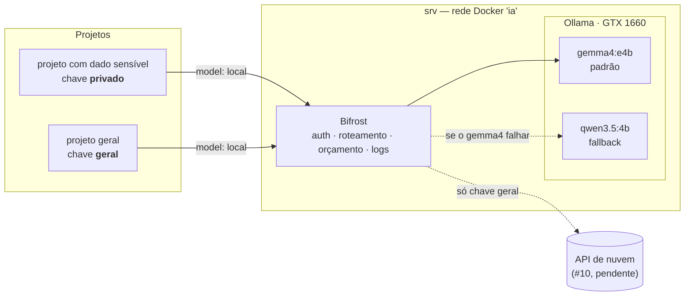

# Etapa 1 — Plataforma de IA privada

Um **gateway único** na frente dos modelos. Os projetos não falam com o Ollama nem com a nuvem:
falam com o gateway, com uma chave que define o que podem usar, quanto podem gastar e o que
fica registrado.

## Arquitetura



## Como um projeto usa

O gateway fala o protocolo da OpenAI, então qualquer SDK compatível funciona trocando a URL:

```bash
curl http://<srv-na-tailscale>:8080/v1/chat/completions \
  -H "Authorization: Bearer $CHAVE_DO_PROJETO" \
  -H "Content-Type: application/json" \
  -d '{"model": "local", "reasoning_effort": "none",
       "messages": [{"role": "user", "content": "Classifique este alerta: ..."}]}'
```

- `model: "local"` é um **apelido**: o gateway decide o modelo (hoje gemma4, com fallback no qwen).
  Trocar de modelo, ou de GPU, não muda nada no projeto.
- `reasoning_effort: "none"` é **contrato** para tarefas simples. Sem ele, o qwen liga o modo
  "pensar" e fica 20–30× mais lento (ver #13).

## Chaves

| Chave | Pode usar | Limites | Conteúdo no log |
|---|---|---|---|
| `privado` | só modelos locais | 600 req/h | **não** |
| `geral` | modelos locais (nuvem quando houver) | US$ 5/mês | não (padrão global) |
| `teste-orcamento` | só locais | US$ 0,0005/h | não |
| `teste-limite` | só locais | 3 req/min | não |

Os valores das chaves são gerados no próprio servidor e ficam num `.env` com `chmod 600`.
O repositório só tem as referências (`env.VK_PRIVADO`).

## Custo-sombra

Modelo local não custa nada por chamada. Para o painel mostrar algo útil, os modelos locais são
precificados como o **Claude Haiku 4.5** (US$ 1 / US$ 5 por milhão de tokens de entrada/saída):
o número no painel é **quanto o mesmo uso custaria na nuvem**. Não é gasto real.

## Segurança

- Imagens fixadas por digest; Bifrost com quarentena de 72 h por versão ([ADR 0004](decisoes/0004-gateway-bifrost.md)).
- Portas só em localhost e na Tailscale; pela rede local nem conecta.
- Container do gateway read-only, sem capabilities, usuário sem root.
- Inferência e painel exigem autenticação.
- O Bifrost bloqueia por padrão conexões a IPs privados (proteção anti-SSRF). A exceção foi
  aberta **só** para o provider do Ollama.
- O Bifrost baixa uma tabela pública de preços a cada 24 h: única saída de rede esperada sem rota de nuvem.

## Resultado do teste de aceitação

[`tests/aceitacao_etapa1.py`](../tests/aceitacao_etapa1.py), rodado no srv em 2026-10-22:

```text
[PASSA ] inferência sem chave é recusada — HTTP 401
[PASSA ] inferência com chave falsa é recusada — HTTP 401
[PASSA ] API de gestão sem login é recusada — HTTP 401
[PASSA ] API de gestão com login funciona — HTTP 200
[PASSA ] chave 'privado' + apelido 'local' responde pelo gemma4 — HTTP 200, modelo gemma4:e4b
[PASSA ] chave 'privado' não acessa modelo fora da lista (llama3.1:8b existe no Ollama) — HTTP 403
[PASSA ] reasoning_effort='none' desliga o 'pensar' do qwen — 2 tokens de saída
[PASSA ] com o gemma4 fora, 'local' cai no qwen3.5:4b — HTTP 200, modelo qwen3.5:4b
[PASSA ] gemma4 restaurado e de volta ao serviço — modelo gemma4:e4b
[PASSA ] limite de 3 req/min bloqueia com 429 — códigos [200, 200, 200, 429, 429]
[PASSA ] orçamento de US$ 0,0005/h bloqueia com 402
[PASSA ] logs da chave 'privado' não guardam conteúdo
[PASSA ] logs registram custo-sombra
[PULADO] chave 'privado' recusada ao pedir modelo de nuvem — aguarda #10
[PULADO] Ollama fora: 'privado' falha fechado, 'geral' vai para a nuvem — aguarda #10
[PASSA ] overhead mediano do gateway ≤ 50 ms — mediana 0.6 ms (p10 -0.2, p90 1.1; 30 pares)

14 passaram, 0 falharam, 2 pulados
```

O fallback é testado com **falha real**: a tag do gemma4 é removida do Ollama durante o teste e
restaurada no fim, sem novo download.

## O que aprendemos

- **A ordem importa:** a permissão da chave é checada antes da regra de roteamento. E a variável
  CEL é `model`, não `request.model`. Regra com sintaxe inválida é pulada com um aviso no log, sem erro.
- **Parâmetro nativo nem sempre atravessa o gateway:** `think: false` do Ollama se perde;
  `reasoning_effort` (padrão OpenAI) funciona.
- **Orçamento é checado antes da chamada:** o último pedido permitido pode ultrapassar o limite em
  até uma chamada. Com dinheiro real, o limite deve ter folga.
- **Overhead desprezível:** 0,6 ms de mediana, contra um critério de 50 ms definido antes de medir.

## Pendências

- **#10** — rota de nuvem: depende de uma chave de API (assinaturas de Claude Code/Codex não servem
  como backend de gateway: termos de consumidor e sem métrica de tokens). Antes de ligar, atualizar
  o Bifrost para a v2.3.2 (correção de validação TLS).
- **#13** — impor `reasoning_effort: none` no próprio gateway.
