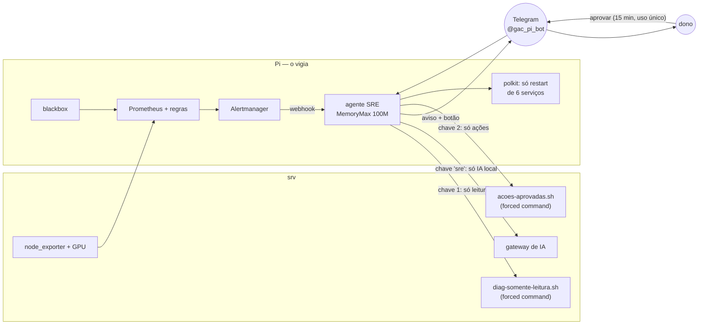

# Etapa 2 — Agente SRE

Um vigia que mora fora da máquina vigiada, e um agente que **investiga e explica** alertas em
português, mas **só age com aprovação humana** e dentro de uma lista fechada.

## Arquitetura

## Fluxo de um alerta

1. **Regra** (Prometheus) dispara com gravidade definida por regra: `critico` ou `atencao`.
2. **Diagnóstico** só de leitura, escolhido pelo tipo de alerta, de um catálogo fechado.
3. **IA local** explica em até 5 linhas: o que aconteceu, provável causa, sugestão.
   A IA **compara a evidência com o alerta** e diz quando ela o contradiz (falso alarme).
4. **Redação** de qualquer coisa que pareça segredo antes de sair do servidor.
5. **Telegram**: aviso + no máximo uma ação sugerida, com botão.
6. **Aprovação**: só o dono, uma vez, em até 15 minutos.
7. **Ação** pelo executor restrito, seguida de **conferência independente** (HTTP ou estado do serviço).

Se a IA ou o srv estiverem fora, o aviso sai **montado só pelas regras**, com a evidência coletada.

## Modelo de segurança

| Risco | Contenção |
|---|---|
| Agente comprometido executa comando arbitrário no srv | Duas chaves SSH, cada uma presa a um *forced command* com catálogo fechado e alvo validado por regex ancorada; `from=` restrito ao IP do Pi; recusas registradas no journal do srv |
| Chave de diagnóstico usada para agir (ou o contrário) | Chaves separadas; testado nos dois sentidos |
| Agente reinicia/para serviço crítico do Pi | polkit permite só `restart` de 6 serviços; `stop`, SSH e Tailscale negados; `NoNewPrivileges` mantido |
| Clique de terceiro, clique repetido, botão antigo | Token aleatório de uso único, 15 min, conferência do id do dono; estado persistido |
| IA rebaixa um alerta grave | Gravidade vem da regra; a IA nem recebe permissão para opinar sobre ela |
| Segredo vazando para o Telegram (nuvem) | Redação por padrões (chaves de API, bearer, senhas, token de bot) |
| Agente derruba o Pi por memória | `MemoryMax=100M`, `CPUQuota=50%`; usa ~21 MB |

## O Pi que reiniciava sozinho

Durante a etapa, investigamos as quedas do Pi (17/10, 20/10, 22/10): sem subtensão, o journal
termina **sem sequência de desligamento**, e na de 22/10 houve um OOM kill 17 s antes. A causa
provável é *thrashing* no swap zram (que fica dentro da RAM) até o sistema travar, quando o
**watchdog de hardware** (`RuntimeWatchdogSec=1min`) reinicia a placa.

Correções:

- Regra `PiPertoDeTravar`: < 12% de memória **e** zram > 60% por 1 minuto (o kernel do Pi não expõe PSI).
- **earlyoom**: mata o maior consumidor (preferindo testes em node/vitest) antes do travamento;
  serviços de uso diário marcados com `OOMScoreAdjust=-900`.
- O diagnóstico de memória mostra o **comando completo** dos maiores processos, para a IA dizer
  quem está consumindo, em vez de só "node".

## Teste de falhas injetadas

Pré-registro: [`testes/0001-falhas-injetadas-prereg.md`](testes/0001-falhas-injetadas-prereg.md).
Resultado: *(preenchido após a rodada)*.
